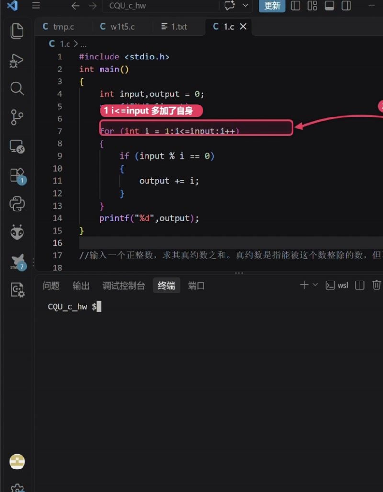
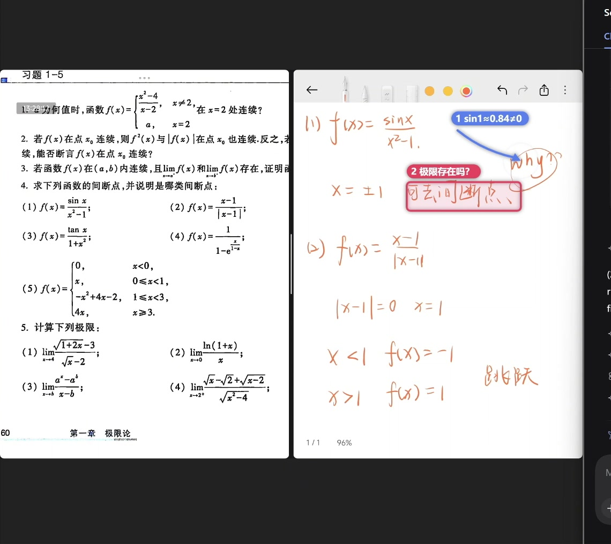
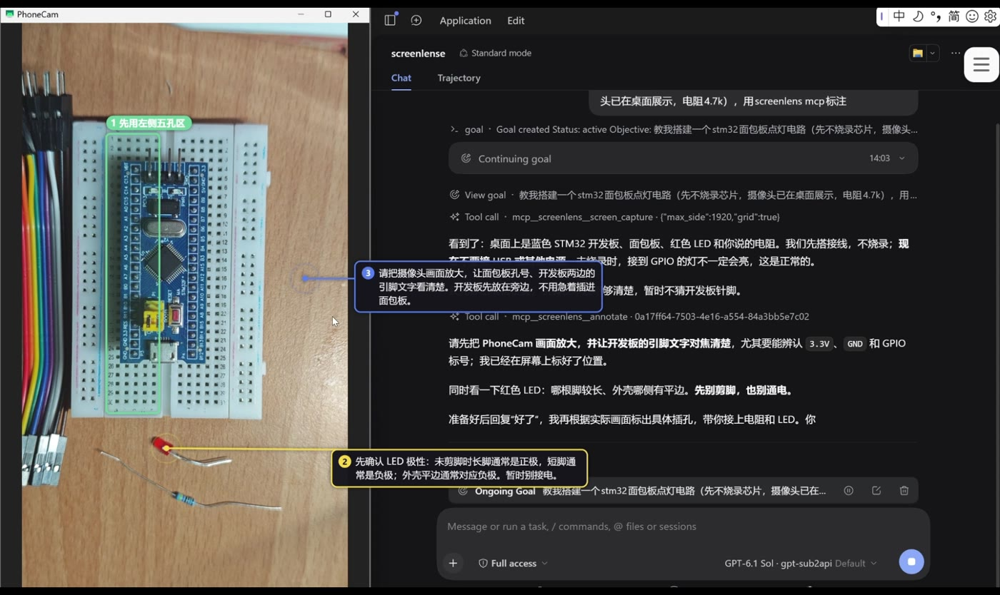

# ScreenLens MCP

让 AI Agent **看见你的屏幕、在屏幕上直接指给你看**的 MCP 服务。

配好就能用，不需要打开任何窗口——它在后台以无 GUI 服务运行，Agent 调用时才拉起。

- 🖥 **screen_capture** — 截取屏幕，返回带坐标网格的图片
- 📷 **camera_capture** — 拍一张摄像头画面（**每次都会弹窗请你确认**）
- ✏️ **annotate** — 在真实屏幕上画框 / 圈 / 箭头 / 文字气泡，默认 5 秒后自动消失
- 👁 **watch_next** — 阻塞观察，画面出现变化才返回截图，本地检测不花 token
- 🗂 **list_displays / list_cameras / list_windows** — 枚举屏幕、摄像头、窗口

> Windows 10/11。macOS / Linux 未实现。

## 实际效果

以下都截自真实使用录像，标注画在用户自己的屏幕上。

| 找 bug | 讲解题目 |
|---|---|
|  |  |
| 圈出 `i<=input` 多算了自身，红框 + 标签直接压在出错的那一行上 | 蓝色引线指向可疑式子，红标签给出结论「可去间断点」 |



左侧是摄像头画面（正对着桌上的面包板），右侧是 Agent 的解释。①②③ 三个标号把「先接这里」「先确认极性」「把镜头放大」直接指在实物上。

---

## 快速开始

需要 Node.js 18+。

```bash
git clone <this-repo> screenlens-mcp
cd screenlens-mcp
npm install
npm run build
```

然后接入你用的客户端（可多选）：

```bash
node scripts/install-mcp.mjs dsh     # DeepSeek Harness
node scripts/install-mcp.mjs codex   # Codex
node scripts/install-mcp.mjs claude  # Claude Code
```

脚本会写入对应客户端的 MCP 配置，并把原有配置备份成 `*.bak-screenlens-<时间戳>`。

重启客户端后，直接对 Agent 说「看一下我的屏幕，告诉我哪里报错了」即可。

### 手动配置

想自己写配置的话（以 Claude Code / Codex 的 stdio 格式为例）：

```json
{
  "mcpServers": {
    "screenlens": {
      "command": "node",
      "args": ["/绝对路径/screenlens-mcp/mcp/screenlens-mcp.mjs"]
    }
  }
}
```

首次调用工具时，它会自动在后台启动 ScreenLens 服务（无窗口、无托盘弹窗），
之后所有调用都走这个常驻服务。你也可以手动启动：

```bash
node scripts/start.mjs --service
```

---

## 工具说明

坐标一律是**归一化 0~1000**：图片左上角 `(0,0)`，右下角 `(1000,1000)`，与分辨率无关。
返回的图片默认叠加半透明橙色网格（每 100 一条），用来精确读坐标，网格不属于画面内容。

| 工具 | 作用 | 关键参数 |
|---|---|---|
| `screen_capture` | 截屏 | `display`（cursor/primary/序号）、`grid`、`max_side` |
| `camera_capture` | 摄像头取一帧 | `reason`（**显示在确认框里**）、`device_id` |
| `annotate` | 在屏幕上标注 | `annotations[]`、`seconds`（默认 5，0 = 直到按 Esc） |
| `clear_annotations` | 清除标注 | — |
| `watch_next` | 阻塞观察画面变化 | `window`、`sensitivity`、`timeout_sec` |
| `watch_stop` | 停止观察 | — |
| `list_displays` | 列出显示器 | — |
| `list_cameras` | 列出摄像头（不打开设备） | — |
| `list_windows` | 列出窗口 | — |

### 标注类型

```jsonc
[
  {"type": "box",    "bbox": [x1, y1, x2, y2], "label": "说明"},
  {"type": "circle", "bbox": [x1, y1, x2, y2], "label": "说明"},
  {"type": "arrow",  "from": [x, y], "to": [x, y], "label": "说明"},
  {"type": "text",   "at": [x, y], "text": "可以多行\n也可以带尾巴", "to": [x, y]}
]
```

`text` 是独立文字气泡：`at` 是气泡中心，自动折行、超出屏幕自动内收，`to` 可选，
画一条引线指向目标。适合直接在画面上写解释和改法。

---

## 隐私

这几条是**代码层强制**的，改参数绕不过去：

- **摄像头必须确认**：每次 `camera_capture` 都会弹出系统对话框，可选「拒绝 / 仅这一次 / 10 分钟内允许」，
  60 秒不选视为拒绝。拒绝后 30 秒内的重复请求直接被拒，防止 Agent 反复弹窗。
  授权只存在内存里，服务重启即失效，托盘菜单可随时撤销。
- **标注不会挡住观察**：`watch_next` 会忽略屏幕上标注所覆盖的区域，所以标注挂着也能继续观察，
  且标注的出现/消失本身不会触发提醒。
- **数据不出本机**：截图、摄像头画面只回传给调用你的那个 Agent，ScreenLens 自己不做任何上传。
- **隐私黑名单**：可在设置里配置程序名单，这些程序在前台时自动观察一律暂停。

---

## 工作原理

```
┌────────────┐   stdio (MCP)    ┌──────────────────┐   127.0.0.1 + token   ┌───────────────────┐
│  AI Agent  │ ◄──────────────► │ screenlens-mcp   │ ◄───────────────────► │ ScreenLens 服务   │
│ (DSH/Codex)│                  │  .mjs（零依赖）  │                       │ (Electron 无窗口) │
└────────────┘                  └──────────────────┘                       └───────────────────┘
```

- `mcp/screenlens-mcp.mjs` 是零依赖的 stdio MCP 服务，只做协议转换。
- 干活的 ScreenLens 服务是个 Electron 进程，但**以 `--service` 模式运行：窗口永不显示**，
  只保留托盘图标（打开设置 / 撤销摄像头授权 / 退出）。
- 两者通过 `%APPDATA%\ScreenLens\bridge.json` 里的端口和一次性 token 通信，只监听 `127.0.0.1`。
- 服务没起来时，MCP 会自动拉起它，用户无需手动启动。

### 为什么需要 Electron

截屏、屏幕覆盖层、摄像头取帧都要 Chromium 的能力（`desktopCapturer`、透明置顶窗口、`getUserMedia`）。
Electron 二进制随 `npm install` 自动下载，**不需要你额外安装或打开任何应用**。

---

## 目录结构

```
mcp/screenlens-mcp.mjs     stdio MCP 服务（协议层，零依赖）
src/main/                  主进程：服务模式、截屏、覆盖层、摄像头确认、观察循环、本地 bridge
src/shared/                标注解析、几何布局、SVG 绘制、画面 diff（纯逻辑，可单测）
src/renderer/              渲染进程：加网格/缩放、摄像头取帧（服务模式下窗口不显示）
src/overlay/               屏幕覆盖层页面
scripts/                   build / setup / start / e2e / 可视化测试
```

`src/renderer` 里的聊天界面是可选的调试与设置入口，MCP 用法完全不需要它。

## 开发

```bash
npm run build      # 构建
npm run typecheck  # 类型检查
npm start          # 带 GUI 启动（调试用）
npm run visual     # 无头可视化测试，输出 .e2e/*.png
npm run e2e        # MCP 端到端测试
node scripts/run-ts.mjs scripts/test-diff.ts   # 观察算法单测
```

## License

MIT
